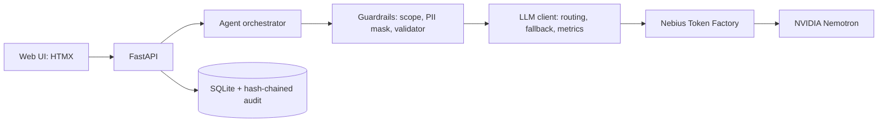

# CareFlow Memory

A private operations assistant that remembers one hospital front-desk staff member's open loops: pending reports, open
referrals and promised follow-ups. It summarises the day, drafts shift handovers with a "what changed" diff, and keeps a
tamper-evident audit trail. It never gives clinical advice.

Built for the **Personal AI** track of the Nebius x NVIDIA Global AI Hackathon 2026. All model calls go through
**Nebius Token Factory** using **NVIDIA Nemotron** models routed by task.

> Synthetic data only. Administrative assistant, no medical advice.

## What it does

| Feature | Detail |
| --- | --- |
| Today | Urgency-sorted open loops with ageing badges: overdue, stuck, due today, awaiting |
| Ask | Natural-language questions answered from records, every answer cites record IDs |
| Confirm cards | The AI proposes writes (status change, note). Nothing is saved until a person confirms |
| Handover | One click builds Critical, Watch list, Pending, Completed and Notes, with a diff since the last shift. Edit, sign, export Markdown |
| Memory | Notes saved today are recalled in later sessions. View, edit and delete them |
| Audit trail | Hash-chained, append-only. Integrity check names the first broken entry |
| Scope guard | Clinical requests are refused and the refusal is logged |
| Models | Routing table plus measured model, tokens and latency, and an Ultra vs Super comparison |

## Run it

```bash
cp .env.example .env        # add NEBIUS_API_KEY for live mode; leave empty for offline demo mode
docker compose up --build   # http://localhost:8000
```

Without Docker: `pip install -r requirements.txt && uvicorn app.main:app --port 8000`.
Tests: `python -m unittest discover -s tests -t .`

**Offline demo mode** (no API key) answers from the same grounded records using rules, so the demo never depends on a
network call. Live mode adds the Nemotron models. The Models page shows which mode is active.

## Architecture



## Nemotron routing

| Task | Tier | Why |
| --- | --- | --- |
| Scope check, note extraction | Nano | Fast, high volume |
| Chat answers over retrieved records | Super | Balanced quality and speed |
| Shift handover, audit explanations | Ultra, falls back to Super then Nano | Reasoning over many records |

Model IDs and base URL are set in `.env`. Confirm them in the Token Factory console.

## Safety and privacy

- Patient names are replaced with tokens (`PATIENT_007`) before any model call, including retrieved notes. The LLM client
  raises an error if a raw name is about to leave the process, and a test asserts it.
- Answers must cite record IDs. The validator rejects unknown IDs and clinical phrasing, and the app shows a grounded answer instead.
- Notes are wrapped as data and a test confirms an injected instruction in a note does not change output.
- AI-proposed writes need confirmation. Direct edits and deletes on the Memory page are explicit human actions, and are logged.
- Audit entries chain SHA-256 hashes. The Audit page has a tamper demo (Admin role) that shows the check catching an edit.
- Role switch is a demo stand-in for real authentication.

## Results on the demo set

These are results on seeded synthetic data and small test sets, not general claims. Fill the measured rows from your runs.

| Metric | Target | Measured |
| --- | --- | --- |
| Planted overdue (9) and stuck (3) items found | all | 12 of 12 (test suite) |
| Clinical-advice leakage, 30 red-team prompts | 0 of 30 | 0 of 30 (rule layer, test suite) |
| Admin prompts wrongly refused, 10 prompts | 0 | 0 of 10 |
| Handover time, manual baseline | about 20 min | to measure |
| Handover time, CareFlow | under 2 min | to measure |
| Ultra vs Super handover latency | Ultra within 20 s | to measure on Models page |
| Average chat latency | under 5 s | to measure on Models page |

## Limitations

Synthetic data only, no EHR integration. SQL notes with keyword retrieval, not a vector index. Single-user role switch,
not full authentication. Scope rules are pattern-based plus a Nano check in live mode, so they are not exhaustive.

## License

MIT
