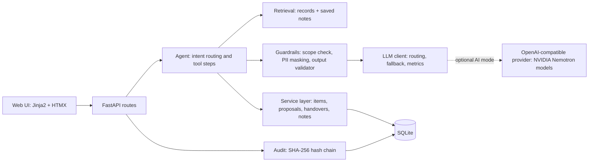

# CareFlow Memory

**A private operations assistant that remembers a clinic's open loops, so nothing slips between shifts.**

CareFlow Memory keeps track of the administrative work that hospitals and clinics run on: pending reports, open referrals and promised follow-ups. It summarises the day, prepares shift handovers with a "what changed" diff, answers questions with record citations, and keeps a tamper-evident audit trail of every action. It never gives clinical advice.

> Live demo: https://careflow-memory.onrender.com (synthetic data, administrative assistant, no medical advice)

---

## The problem

Front-desk and operations staff in clinics carry a large number of unfinished tasks in their heads, in spreadsheets and on sticky notes.

- A referral is sent, but nobody confirms the other department received it.
- A lab report is pending, and the patient needs a call-back that never happens.
- A follow-up is promised, but never booked.
- At shift change, pending work is passed on verbally, and details get lost.

The result is missed follow-ups, delayed care, duplicated work, and no clean record of who did what and when. Hospital information systems store records but do not remember context or summarise work. General chatbots forget everything between sessions and are hard to trust with sensitive workflows.

## The solution

CareFlow Memory treats **unfinished work as first-class memory** instead of chat history. Every task, referral, follow-up and awaited report is a tracked object with a status, a due date and an age. On top of that sits an assistant that:

1. shows what needs attention first (overdue, stuck, due today, awaiting),
2. answers questions from the records and cites the record IDs it used,
3. proposes changes, but only saves them after a person confirms,
4. builds a structured shift handover and highlights what changed since the last one,
5. remembers notes across sessions ("send an SMS first, then call"),
6. logs every read, write and AI suggestion in a hash-chained audit trail,
7. refuses clinical questions (medicine, diagnosis, treatment) and logs the refusal.

---

## Features

| Page | What it does |
| --- | --- |
| **Today** | Urgency-sorted open loops with ageing badges: Overdue, Stuck, Due today, Awaiting. KPI cards for open, overdue, stuck referrals and awaited reports. Each record has a History link. |
| **Ask** | Natural-language questions answered from the records. Every answer cites record IDs (for example `REF-005`). Writes appear as confirm cards with the current value, the proposed value and the reason. |
| **Handover** | One click builds Critical, Watch list, Pending, Completed and Notes, plus a "since the last shift" diff (New, Resolved, Changed, Now overdue). Edit the summary, sign and save, and export as Markdown. |
| **Memory** | Notes the assistant remembers across sessions. View, edit and delete them. Notes are treated as data, never as instructions. |
| **Audit trail** | Append-only log with actor, time, action, record, before, after, an AI flag and a hash. Search by record, person or action. Verify integrity with one click. |
| **Models** | The model routing table, mode (offline or AI), measured calls (model, tokens, latency), and a benchmark that runs the same handover on two model tiers. |

### Roles

A role switch in the sidebar changes who is acting. The role is recorded in the audit log.

| Role | Acting as | Notes |
| --- | --- | --- |
| Coordinator | Priya Nair | Day-to-day front-desk work |
| Nurse | Rahul Verma | Handovers and task updates |
| Admin | Compliance Officer | Also runs the audit tamper demo and can reset demo data |

### Things to try

- "Which referrals are stuck?"
- "What is pending for Cardiology today?"
- "Mark REF-005 as Acknowledged" (shows a confirm card, nothing is saved until you confirm)
- "Remember that Fatima Sheikh prefers an SMS first"
- "Who changed REF-005?"
- "What medicine should I give?" (refused, and the refusal is logged)
- Handover, then Generate, edit, Sign and save, Export Markdown
- Audit trail, then Verify integrity, then (as Admin) Run tamper demo

---

## Architecture



### Request lifecycle (Ask)

1. The user sends a message from the Ask page.
2. The **scope guard** checks whether it is administrative or clinical. Clinical requests get a refusal, and the refusal is logged.
3. The agent decides the intent: a question, a note to remember, a status change, or an audit question.
4. **Retrieval** pulls the relevant records and saved notes.
5. **PII masking** replaces patient names with tokens such as `PATIENT_007` before any model call. The LLM client raises an error if a raw name is about to leave the process.
6. The answer comes from the model in AI mode, or from grounded rules in offline mode.
7. The **output validator** checks record citations and blocks clinical phrasing. If a model answer fails validation, the app shows a grounded answer instead.
8. Names are restored for display, the answer is shown with citation chips, and any proposed write appears as a confirm card.
9. The interaction is written to the audit log.

### Two modes

| Mode | When | How it works |
| --- | --- | --- |
| **Offline** (default) | No API key set | Answers, handover text and extraction come from rules over the same grounded records. No network call. Everything in the app works. |
| **AI** | `NEBIUS_API_KEY` set | The same pipeline, with NVIDIA Nemotron models producing the answer and handover narrative through an OpenAI-compatible API. The Models page shows the active mode. |

### Model routing (AI mode)

Each task uses the smallest model that does it well. Model IDs and the base URL are set in `.env`, so you can point to any OpenAI-compatible provider that serves them.

| Task | Tier | Why |
| --- | --- | --- |
| Scope check, note extraction | Nano | Fast and cheap, runs on every message |
| Chat answers over retrieved records | Super | Balanced quality and speed |
| Shift handover, audit explanations | Ultra, falls back to Super, then Nano | Reasoning over many records |

Every call is recorded (task, tier, model, tokens in and out, latency, success) and shown on the Models page.

### Data model

SQLite, created automatically on first start.

| Table | Purpose |
| --- | --- |
| `patients` | Synthetic patient IDs and names |
| `items` | Tasks, referrals, follow-ups and reports: kind, patient, department, title, status, priority, due date, created and updated times |
| `notes` | Operational notes remembered across sessions: patient, text, author, time |
| `proposals` | AI-proposed writes waiting for confirmation: actor, payload, status (pending, confirmed, cancelled) |
| `handovers` | Generated handovers: body, snapshot of the record state, signed flag, model used, latency |
| `audit` | Append-only log with `prev_hash` and `hash` for each entry |
| `llm_calls` | Per-call metrics for the Models page |

### Ageing and status rules

- **Overdue:** an open record whose due date has passed. The badge shows days overdue.
- **Stuck:** an open referral in Created, Sent or Acknowledged that has not changed for `STUCK_DAYS` (default 5), or one marked Stuck.
- **Due today** and **Awaiting** (reports) have their own badges.
- Closed records (Completed, Done) move to "Recently closed".

### Audit trail

Each entry stores the SHA-256 of the previous hash plus its own contents. Verification recomputes the chain from the start and reports the first entry that does not match, along with how many earlier entries are intact. The Admin-only tamper demo edits a past entry directly in the database so you can watch the check catch it. Reset the demo data afterwards (Admin role, `POST /admin/reset`) or delete `data/careflow.db` and restart.

### Safety and privacy

| Concern | How it is handled |
| --- | --- |
| Clinical advice | Pattern-based scope guard, plus a model check in AI mode, plus an output validator that blocks advice phrasing. Refusals are logged. |
| PII leaving the process | Names replaced with tokens before any model call, including retrieved notes. A hard check raises an error if a raw name is found in an outbound payload. |
| Hallucinated records | Answers must cite record IDs, and the validator rejects unknown IDs. A failing model answer is replaced with a grounded one. |
| Prompt injection | Notes are wrapped as data. An instruction hidden in a note cannot change the output. |
| Unreviewed writes | AI-proposed changes need confirmation. Direct edits and deletes on the Memory page are explicit human actions and are logged. |
| Tampering | Hash-chained audit log with an integrity check. |
| Secrets | Keys live in `.env`, which is excluded from git. |

All data in the demo is synthetic. There are no real patients.

---

## Run it

### Option 1: Docker

```bash
cp .env.example .env        # leave NEBIUS_API_KEY empty for offline mode
docker compose up --build
```

Open http://localhost:8000

### Option 2: Python (Windows PowerShell)

```powershell
python -m venv .venv
Set-ExecutionPolicy -Scope Process -ExecutionPolicy Bypass
.\.venv\Scripts\Activate.ps1
pip install -r requirements.txt
uvicorn app.main:app --port 8000 --reload
```

### Option 2: Python (macOS / Linux)

```bash
python3 -m venv .venv
source .venv/bin/activate
pip install -r requirements.txt
uvicorn app.main:app --port 8000 --reload
```

Open http://127.0.0.1:8000. The database and demo data are created on first start.

### Run the tests

```bash
python -m unittest discover -s tests -t .
```

### Turn on AI mode

1. Copy the example file: `cp .env.example .env` (Windows: `copy .env.example .env`).
2. Set `NEBIUS_API_KEY` in `.env`.
3. List the model IDs your provider serves and copy them into `.env`:

```bash
python -c "from app import config; from openai import OpenAI; c=OpenAI(api_key=config.API_KEY, base_url=config.BASE_URL); print([m.id for m in c.models.list().data if 'nemotron' in m.id.lower()])"
```

4. Restart the server. The Models page now shows mode **live**, and the benchmark compares two tiers on the same handover.

### Configuration

| Variable | Default | Meaning |
| --- | --- | --- |
| `NEBIUS_API_KEY` | empty | Provider API key. Empty means offline mode. |
| `NEBIUS_BASE_URL` | `https://api.tokenfactory.nebius.com/v1/` | Any OpenAI-compatible endpoint |
| `MODEL_NANO` | `nvidia/nemotron-3-nano` | Scope check and extraction |
| `MODEL_SUPER` | `nvidia/nemotron-3-super` | Chat answers |
| `MODEL_ULTRA` | `nvidia/nemotron-3-ultra` | Handover and audit explanations |
| `STUCK_DAYS` | `5` | Days without change before a referral counts as stuck |
| `CAREFLOW_DB` | `data/careflow.db` | SQLite file path |

### Deploy (Render, Docker)

1. Push the repo to GitHub.
2. On Render, create a **Web Service** from the repo and choose the **Docker** runtime.
3. Set the environment variable `PORT=8000`.
4. Leave `NEBIUS_API_KEY` empty for offline mode, or add it (and the model IDs) to enable AI mode.
5. A health endpoint is available at `/healthz`. It returns `{"ok": true, "mode": "offline"}` or `"live"`.

---

## Demo data

Twelve synthetic patients and 21 records (tasks, referrals, follow-ups, reports) are seeded with deliberate problems so the behaviour is easy to see: 9 overdue items and 3 stuck referrals. Dates are relative to today, so the demo always looks current. Several records change after the first handover so that the "since the last shift" diff has content.

## What the tests cover

`tests/test_core.py` has 13 tests:

| Area | Test |
| --- | --- |
| Logic | The planted overdue and stuck items are all found |
| Audit | The chain verifies, and an edited entry is detected |
| Scope | A red-team set of clinical prompts is refused, administrative prompts are allowed, and refusals are logged |
| Validation | The validator rejects unknown record IDs and advice phrasing, and a bad model answer falls back to a grounded one |
| Privacy | No raw patient names reach the model, and the leak check raises when it should |
| Injection | An instruction injected through a note cannot force advice |
| Workflow | A write needs confirmation and is then recalled, the status-change flow works, and the handover diff and signing work |

## Project structure

```
app/
  main.py         FastAPI routes and page rendering
  agent.py        Intent routing, retrieval, grounded answers
  service.py      Records, proposals, notes, handover building, benchmark
  guard.py        Scope guard, PII masking, output validator
  llm.py          LLM client: routing, fallback, metrics
  audit.py        Hash-chained audit log and verification
  db.py           SQLite schema and helpers
  seed.py         Synthetic demo data
  config.py       Environment configuration
  templates/      Jinja2 + HTMX pages and partials
  static/app.css  Styles
tests/            Unit tests
Dockerfile        Container image
docker-compose.yml
requirements.txt
.env.example
LICENSE
```

## Tech stack

Python 3.12, FastAPI, Uvicorn, Jinja2, HTMX, SQLite, the OpenAI Python client (for OpenAI-compatible providers), NVIDIA Nemotron models, Docker.

## Roadmap

- Read-only FHIR/HL7 connectors for a clinic pilot
- Semantic memory with embeddings and a scheduled daily digest
- Voice dictation for handovers
- English and Hindi support
- On-premise deployment with open models for data residency
- Compliance work toward India's DPDP Act, and HIPAA or GDPR for other markets

## License

MIT. See [LICENSE](LICENSE).
